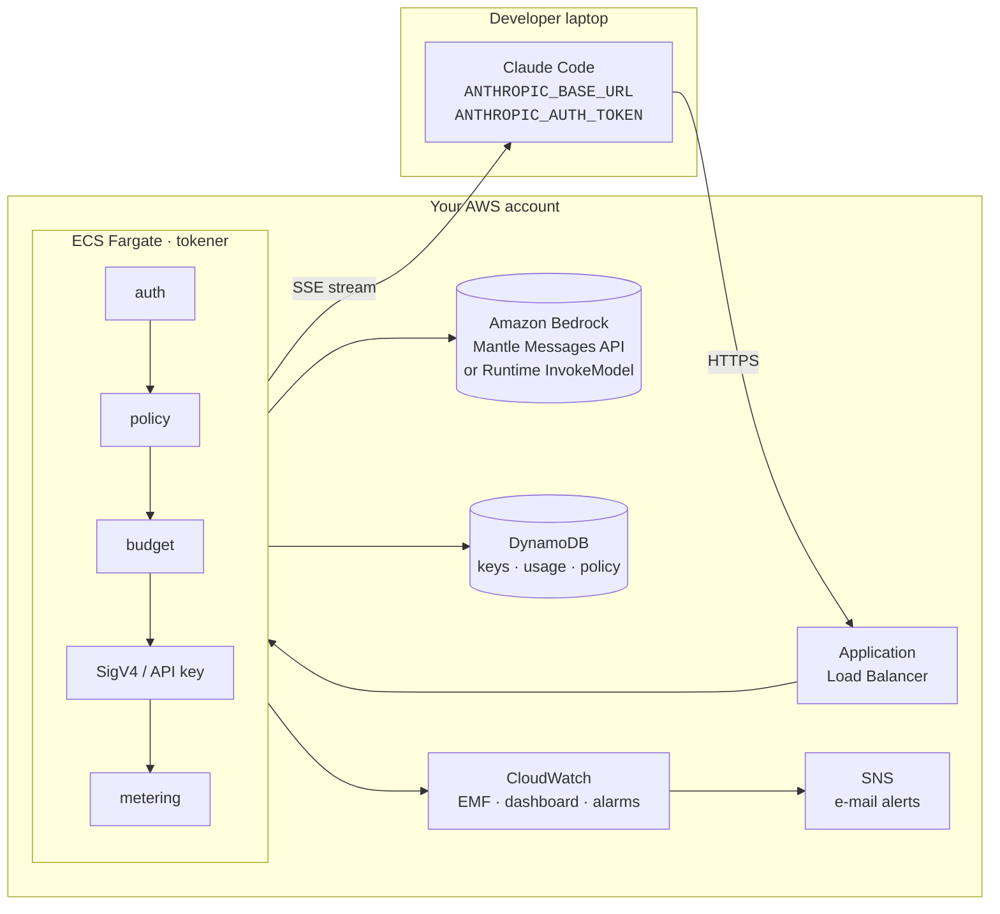
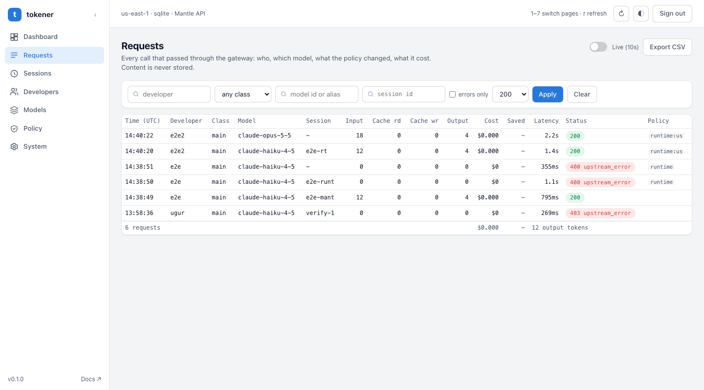
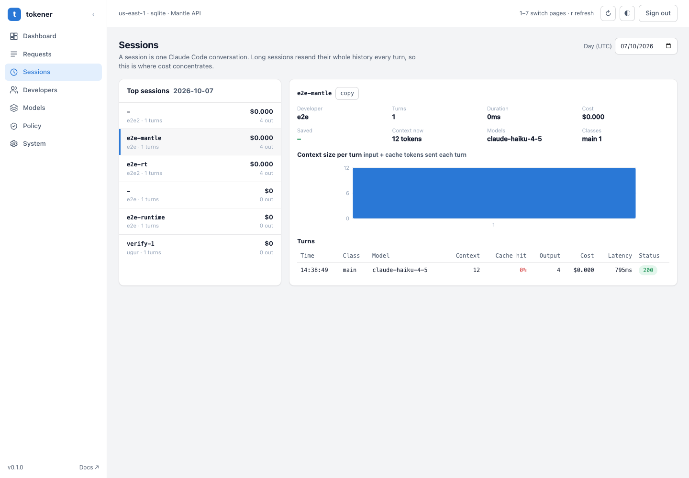
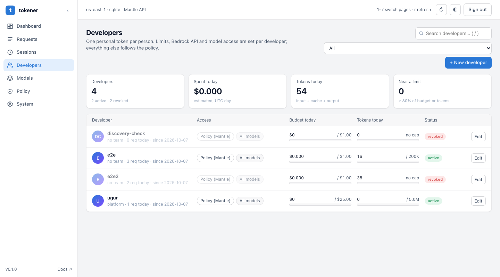
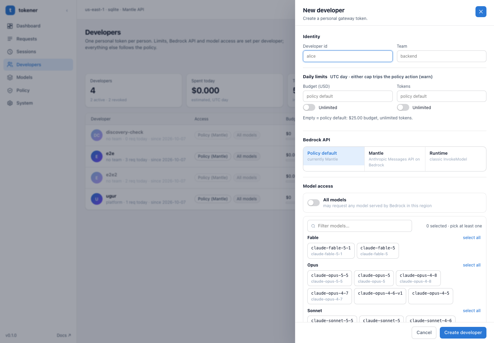
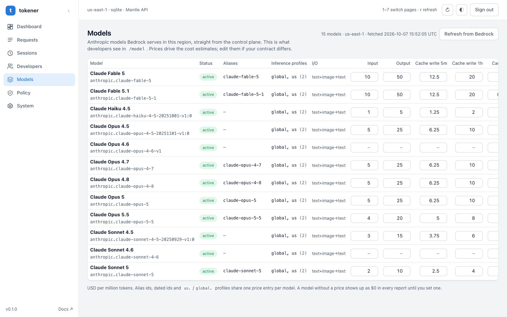
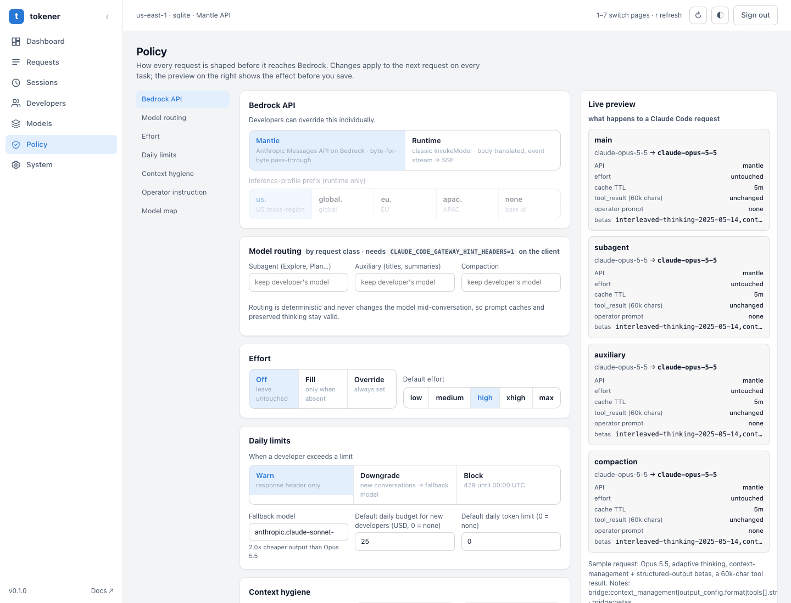
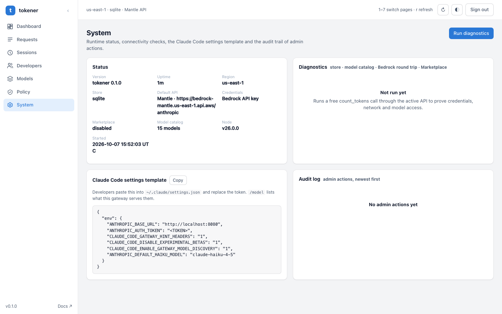

<div align="center">


<br>

[](https://github.com/uurtech/tokener/actions/workflows/ci.yml)
[](LICENSE)


**A drop-in API gateway that measures and cuts the token cost of Claude Code on Amazon Bedrock.**<br>
Developers install nothing. They get a URL and a personal token, and the gateway handles the rest.

[Quick start](#-quick-start-local-5-minutes) ·
[Features](#-features) ·
[Admin console](#-admin-console) ·
[Deploy to AWS](#-deploy-to-aws) ·
[Configuration](#%EF%B8%8F-configuration) ·
[Türkçe](README.tr.md)

</div>

---

## 💡 Why

In its agent loop, Claude Code resends the whole conversation on every turn. A 10-person team
can easily spend **$2,000–3,000 a month** on tokens, and nobody can see who spent it on what.

tokener sits between Claude Code and Bedrock and implements Claude Code's official gateway protocol.
It does three jobs:

<table>
<tr>
<td width="33%" valign="top">

### 👀 Visibility
Logs every request by developer, session, model and **request class** (main, subagent,
background, compaction). Shows cost, cache hit rate and the most expensive sessions.

</td>
<td width="33%" valign="top">

### 🧭 Policy
Applies deterministic rewrites to the request body: routes subagent and background traffic to
cheaper models, fills in a default effort, adds a team instruction, trims oversized tool output, and strips fields Bedrock rejects.

</td>
<td width="33%" valign="top">

### 🛑 Control
Sets a daily **USD budget** and/or **token limit** per developer. At 80% it sends a warning
header; once the limit is passed it can warn, downgrade to a cheaper model, or block.

</td>
</tr>
</table>

> [!IMPORTANT]
> **What tokener never does:** summarize history, drop messages, or switch models mid-conversation.
> Any of those breaks the prompt cache and invalidates thinking blocks on Opus 5.5 / Sonnet 5.5.
> Every rewrite is deterministic (the same input always gives the same output), so the prompt cache and preserved thinking keep working.

**Expected impact:** 15–20% lower cost with the safe policies, and 30–35% with effort tuning on top.
Infrastructure costs about **$75/month**. Assumptions and math are in [docs/COST_MODEL.md](docs/COST_MODEL.md) (Turkish).

## 🏗 Architecture



There are **two run modes** with the same code and the same UI:

| | Local | AWS |
|---|---|---|
| Storage | SQLite (`gateway/data/gateway.db`) | DynamoDB |
| Credentials | Your own AWS credentials or a Bedrock API key | ECS task role |
| Start | `npm run local` | `npx cdk deploy` |

There are also **two Bedrock APIs**, and you can switch between them live from the console:

- **Mantle**: the Anthropic Messages API endpoint on Bedrock. Requests are forwarded byte for byte.
- **Runtime**: classic `InvokeModel` / `InvokeModelWithResponseStream`. The gateway translates the body,
  converts the AWS event stream into SSE, and calls the model through its `us.` / `global.` inference profile id.

Nothing changes for developers either way.

## ✨ Features

| | |
|---|---|
| 🔌 **Zero install** | Two lines in `~/.claude/settings.json`. Developers need no AWS credentials. |
| 🧠 **Request-class routing** | Sends `subagent`, `auxiliary` and `compaction` traffic to its own model (e.g. Sonnet or Haiku). |
| 🎚 **Effort control** | `fill` sets a default effort when the request has none. `override` always sets it. |
| ✂️ **Tool-output trimming** | Shortens huge `tool_result` text but keeps its head and tail. |
| 🧷 **Bedrock bridging** | Strips beta fields and headers that Bedrock rejects, so you avoid `400 Extra inputs are not permitted`. |
| 💸 **Budgets & token limits** | Daily per-developer limits with `warn` / `downgrade` / `block`, reported in `x-gateway-budget*` headers. |
| 📚 **Live model catalog** | Builds `/v1/models` from Bedrock (`ListFoundationModels` + `ListInferenceProfiles`), so `/model` just works. |
| 📊 **Observability** | CloudWatch EMF metrics, a dashboard and alarms, plus an in-app dashboard with a 14-day trend. |
| 🔐 **Privacy by design** | Conversation content is never stored. Tokens are kept only as hashes, and logs contain numbers only. |
| 🛒 **Marketplace-ready** | A hardened CloudFormation template with HTTPS only, private subnets, Secrets Manager and `RegisterUsage` metering. |

## 🖥 Admin console

A built-in console at `/admin` with a sidebar, light and dark themes, and keyboard shortcuts. Policy changes
take effect immediately, with no redeploy.

<div align="center">

<br><sub><b>Dashboard</b>: estimated cost, policy savings, cache hit rate, 14-day trend, cost by developer, model and request class</sub>
</div>

<br>

<table>
<tr>
<td width="50%" align="center"><br><sub><b>Requests</b>: filters, live refresh, CSV export</sub></td>
<td width="50%" align="center"><br><sub><b>Sessions</b>: turns and context growth per session</sub></td>
</tr>
<tr>
<td width="50%" align="center"><br><sub><b>Developers</b>: tokens, limits, token rotation</sub></td>
<td width="50%" align="center"><br><sub><b>New developer</b>: API override and model allowlist</sub></td>
</tr>
<tr>
<td width="50%" align="center"><br><sub><b>Models</b>: live Bedrock catalog and price editing</sub></td>
<td width="50%" align="center"><br><sub><b>Policy</b>: editor with a live preview</sub></td>
</tr>
<tr>
<td colspan="2" align="center"><br><sub><b>System</b>: diagnostics, settings template, audit log</sub></td>
</tr>
</table>

## 🚀 Quick start (local, 5 minutes)

Nothing is deployed to AWS. It runs on your machine with your own credentials: Claude Code talks to `localhost`, and the gateway talks to Bedrock.

**Prerequisites:** Node 22.13+ and AWS credentials with access to the Anthropic models on Bedrock
(if `aws sts get-caller-identity` works, you're set). The identity needs `bedrock-mantle:CreateInference`, plus
`bedrock:ListFoundationModels` and `bedrock:ListInferenceProfiles` for the model list.

```bash
git clone https://github.com/uurtech/tokener.git && cd tokener/gateway
npm ci && npm run build
cp .env.example .env        # fill in AWS_BEARER_TOKEN_BEDROCK (or IAM keys), AWS_REGION, ADMIN_TOKEN
npm run local
```

The output prints a one-click login link: `http://localhost:8080/admin/#token=<ADMIN_TOKEN>`.
If you leave `ADMIN_TOKEN` empty, a random one is generated and printed.

> [!TIP]
> The easiest credential is a **Bedrock API key** (`AWS_BEARER_TOKEN_BEDROCK`, from Bedrock console → API keys).
> One key works for Mantle, Runtime and the model catalog, with no SigV4 needed. IAM access keys work too; in that case
> the gateway signs requests with SigV4. The `auth` field in `/health` shows which one is in use.
> Shell variables override `.env` (`AWS_PROFILE=myprofile ADMIN_TOKEN=secret npm run local`).

1. Open **Developers** and create a developer. The token is shown once, together with a ready-made settings block.
2. Paste the block into `~/.claude/settings.json`. The local URL is `http://localhost:8080`.
3. Start `claude`. Check that `/status` shows the `Anthropic base URL`, then send a message.
4. Requests, tokens and cost appear on the **Dashboard** right away.

Or with Docker:

```bash
cd gateway && ADMIN_TOKEN=secret AWS_PROFILE=myprofile docker compose up --build
```

## 👩‍💻 Developer setup

Each developer adds this to `~/.claude/settings.json` (or exports the same variables in their shell):

```json
{
  "env": {
    "ANTHROPIC_BASE_URL": "https://claude-gw.example.com",
    "ANTHROPIC_AUTH_TOKEN": "cgw_...",
    "CLAUDE_CODE_GATEWAY_HINT_HEADERS": "1",
    "CLAUDE_CODE_DISABLE_EXPERIMENTAL_BETAS": "1",
    "CLAUDE_CODE_ENABLE_GATEWAY_MODEL_DISCOVERY": "1",
    "ANTHROPIC_DEFAULT_HAIKU_MODEL": "claude-haiku-4-5"
  }
}
```

<details>
<summary><b>What each line does</b></summary>

- `ANTHROPIC_BASE_URL` and `ANTHROPIC_AUTH_TOKEN` are required. The token is sent as `Authorization: Bearer`.
- `CLAUDE_CODE_GATEWAY_HINT_HEADERS=1`: Claude Code reports each request's class (`main`, `subagent`,
  `auxiliary`, `compaction`) in a header. Routing depends on this; without it, every request counts as the main conversation.
- `CLAUDE_CODE_DISABLE_EXPERIMENTAL_BETAS=1`: turns off pre-release fields that Bedrock rejects, at the source.
  The gateway strips them anyway, so this is a second safety net.
- `CLAUDE_CODE_ENABLE_GATEWAY_MODEL_DISCOVERY=1`: makes `/model` read the gateway's `/v1/models`. The list is built
  live from Bedrock and cached for 10 minutes. It contains short aliases first, then every active Anthropic model id and
  inference profile id in the region.
- `ANTHROPIC_DEFAULT_HAIKU_MODEL`: sends background jobs (titles, summaries) to Haiku. `ROUTE_AUXILIARY_MODEL`
  has the same effect on the gateway side, and setting both is harmless.
- Optional: `CLAUDE_CODE_DISABLE_NONESSENTIAL_TRAFFIC=1` turns off traffic that doesn't go through the gateway, such as telemetry and version checks (this also disables auto-update).

</details>

## ☁️ Deploy to AWS

**Prerequisites:** AWS CLI v2 with an active session and Anthropic model access enabled on Bedrock
(Bedrock console → Model catalog → use-case form, once per account), Node.js 22+, Docker, and AWS CDK v2 (`npm i -g aws-cdk`).
A domain and an ACM certificate are optional. Without them the ALB serves HTTP, which is acceptable for a POC only.

```bash
cd gateway && npm ci && npm test           # unit tests
cd ../infra && npm ci
npx cdk bootstrap                          # first time per account/region
npx cdk deploy                             # ~8 min; builds the image and pushes it to ECR
```

Outputs: `GatewayUrl`, `KeysTableName`, `UsageTableName`, `DashboardName`.

```bash
curl -s "$GATEWAY_URL/health"
# {"ok":true,"upstream":"https://bedrock-mantle.us-east-1.api.aws/anthropic"}

./scripts/create-dev-key.sh <KeysTableName> alice 25 backend 5000000
#                                          name  USD/day team tokens/day (0 = none)
```

The token is printed once. DynamoDB stores only its SHA-256 hash. The USD and token limits are independent,
and `BUDGET_ACTION` kicks in when either one is reached first.

> [!NOTE]
> For production and **AWS Marketplace**, use the hardened `tokener-marketplace` template. It enforces HTTPS, uses private subnets,
> restricts the admin console to listed CIDRs, keeps the admin token in Secrets Manager, and meters usage with `RegisterUsage`.
> See [docs/MARKETPLACE.md](docs/MARKETPLACE.md).
>
> ```bash
> cd infra && npm ci && npm run synth:marketplace   # → dist/tokener-marketplace.template.json
> ```

## ⚙️ Configuration

The `env` block in `infra/gateway.config.json` sets the **initial** behavior. Policy saved from the console overrides it
and is persisted. If `adminToken` is empty, `/admin` returns 404. For the first week, **measurement mode** is
recommended: every policy off, bridging on.

<details>
<summary><b>All environment variables</b></summary>

| Variable | Default | Description |
|---|---|---|
| `BRIDGE_BEDROCK` | `true` | Strips fields Bedrock rejects (`context_management`, `output_config.format`, `task_budget`, `strict`, advisor tool) and their beta headers. Keep it on. |
| `ROUTE_SUBAGENT_MODEL` | empty | Model for `subagent` requests, e.g. `anthropic.claude-sonnet-5-5`. |
| `ROUTE_AUXILIARY_MODEL` | empty | Model for background requests such as titles and summaries, e.g. `anthropic.claude-haiku-4-5`. |
| `ROUTE_COMPACTION_MODEL` | empty | Model for compaction summaries. Leaving it on the main model is usually best for quality. |
| `EFFORT_MODE` | `off` | `fill`: set `DEFAULT_EFFORT` when the request has none. `override`: always set it. |
| `DEFAULT_EFFORT` | `high` | `low` `medium` `high` `xhigh` `max` |
| `OPERATOR_PROMPT` | empty | Appended as the **last** system block of every request. |
| `CACHE_TTL_1H` | `false` | Extends all cache breakpoints to 1 hour. Cache writes cost 2×, so enable it only if gaps between turns often exceed 5 minutes. |
| `TOOL_RESULT_MAX_CHARS` | `0` | `0` disables trimming; `20000` is recommended. Trims `tool_result` text but keeps its head and tail. |
| `BUDGET_ACTION` | `warn` | `warn`: report in a header. `downgrade`: start new conversations on `DOWNGRADE_MODEL`. `block`: return 429. |
| `DOWNGRADE_MODEL` | `anthropic.claude-sonnet-5-5` | |
| `MODEL_MAP_JSON` | built-in | Extra Anthropic id → Bedrock id mappings. |
| `PRICING_JSON` | built-in | Overrides the price table used for cost estimates. |
| `TEAM_DAILY_ALERT_USD` | `150` | Threshold for the team-wide daily spend alarm. |
| `AWS_BEARER_TOKEN_BEDROCK` | empty | Bedrock API key. If empty, the gateway uses the task role / IAM credentials with SigV4. |
| `UPSTREAM_MODE` | `mantle` | `mantle` (Messages API) or `runtime` (`InvokeModel`). Can be switched live. |
| `BEDROCK_PROFILE_PREFIX` | `us` | Inference profile prefix added to bare model ids in runtime mode (`us`, `global`, `eu`, `apac`, `none`). |
| `MODEL_CATALOG_ENABLED` | `true` | Builds the model list live from Bedrock. When off, only `MODEL_MAP_JSON` aliases are listed. |
| `MODEL_CATALOG_TTL_MS` | `600000` | How long the catalog is cached (10 min). |
| `UPSTREAM_TIMEOUT_MS` | `120000` | How long to wait for Bedrock's response headers before returning 504. There is no limit once streaming starts. |

Setting `alertEmail` sends alarms by e-mail. Setting `domainName` + `certificateArn` adds an HTTPS listener and an HTTP→HTTPS redirect.

</details>

## 📈 Operating it

<details>
<summary><b>Weekly 30-minute review</b></summary>

1. **Top 5 most expensive sessions.** Find out why each one cost so much: a long session, huge log output, the same retry over and over?
2. **Cache hit rate below 80%.** Something is breaking the prompt prefix. Usual causes: `OPERATOR_PROMPT` edited mid-week, MCP servers
   added mid-session, or breaks longer than 5 minutes. If none of those explain it, consider `CACHE_TTL_1H`.
3. **High output/input ratio.** Look at effort. Try `EFFORT_MODE=fill` + `DEFAULT_EFFORT=high` with two developers for a week.
4. **If everything looks healthy, enable the next lever**, in this order: auxiliary → Haiku, subagent → Sonnet, tool_result trimming, effort, budget downgrade.

```bash
./scripts/usage-report.sh <UsageTableName>              # today, per developer
./scripts/usage-report.sh <UsageTableName> 2026-10-06   # a given day
./scripts/list-dev-keys.sh <KeysTableName>
./scripts/revoke-dev-key.sh <KeysTableName> alice        # access revoked within 60 s
```

Policy changes apply immediately. Other Fargate tasks pick them up within 30 seconds. Changing the operator instruction, effort or routing
invalidates the cache of open conversations once, so make those changes at the end of the day.

</details>

<details>
<summary><b>Scale</b></summary>

Two tasks are plenty for 10 developers: the gateway is I/O-bound, not CPU-bound. Auto-scaling adds tasks at 60% CPU, up to 6.
The default Bedrock quota of 2M input tokens per minute is not a constraint at that size.

</details>

## 🔐 Security

- The ECS task role is the only identity that can call Bedrock. Developers hold no AWS credentials.
- Tokens are stored as SHA-256 hashes. Logs contain counts, the model and the session id, never prompt content.
- Conversation content is never persisted. It is transformed in memory and forwarded.
- `allowedModels` on a key restricts which models that developer can use.
- In production: require an ACM certificate, put WAF in front of the ALB (but turn off body-inspection rules for `/v1/messages`, because prompts that contain code trip the XSS rules),
  and restrict `/admin*` to your office IPs or VPN, or leave `adminToken` empty and manage keys with `scripts/`.

## ⚠️ Limitations

- **Bridging needs ongoing maintenance.** New Claude Code releases may add beta fields that Bedrock rejects. To fix one, add it to `BRIDGE_STRIP_BETAS` or update `bridgeForBedrock`.
- **Prices are estimates.** Cost Explorer is the source of truth; gateway numbers are for ranking and comparison. Use `PRICING_JSON` if your contract prices differ.
- **tool_result trimming** can make the model ask again for the part that was cut. The 20K threshold and the head+tail rule reduce this.
- **Budgets reset daily at UTC midnight.** The token limit counts input, cache read, cache write and output together. A heavy Opus day can reach 20–40M tokens.
- **Structured outputs and server-side tools** (web search, code execution) are not available on Bedrock.

## 🗂 Repository layout

```
gateway/      Node 22.13+ / TypeScript gateway (AWS SDK v3 only; no framework)
  src/        config, auth, policy, policy-state, sse, upstream, usage, admin, server
  src/store/  SQLite (local) and DynamoDB (AWS) storage
  ui/         admin console (static HTML/JS, no build step)
  test/       vitest unit tests + test/smoke/ end-to-end tests against a fake upstream
infra/        AWS CDK: VPC, ECS Fargate, ALB, DynamoDB, CloudWatch, SNS + Marketplace stack
scripts/      create/revoke/list tokens, usage report, release, deploy test
docs/         cost model, Marketplace guide, screenshots
```

## 🧪 Testing

```bash
cd gateway
npm test          # unit tests (vitest)
npm run smoke     # end-to-end checks against a fake Bedrock upstream: no AWS calls
```

The smoke suite checks that SSE is passed through byte for byte, along with model mapping, bridging, effort fill, operator prompt placement,
tool_result trimming, error passthrough and EMF metric output.

## 🗺 Roadmap

- [ ] A separate model per subagent type (`x-claude-code-agent-type`)
- [ ] Prompt-cache pre-warming after compaction
- [ ] Self-service dashboard for developers

## 🤝 Contributing

Issues and PRs are welcome. Before opening a PR, run `npm run typecheck && npm test && npm run smoke` in `gateway/`.
CI runs the same steps and also builds a `linux/amd64` image.

## 📄 License

[MIT](LICENSE) © uurtech

<div align="center">
<sub>Not affiliated with Anthropic or Amazon Web Services. "Claude" is a trademark of Anthropic; "Amazon Bedrock" is a trademark of Amazon.com, Inc.</sub>
</div>
