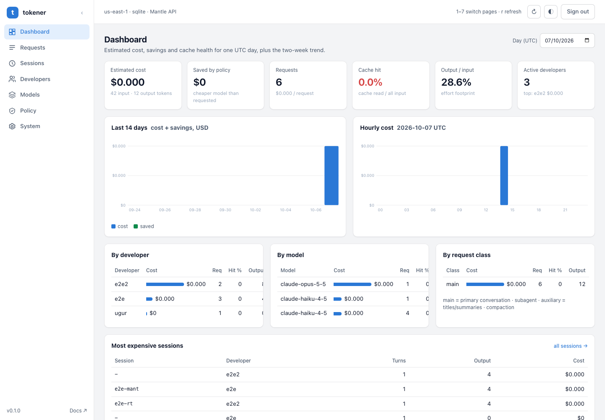

<div align="center"></div>

# tokener — Claude Code → Amazon Bedrock Token Optimizasyon Gateway'i

> 🇬🇧 [English README](README.md)

10 developer'ın Claude Code'u Amazon Bedrock üzerinden kullanırken token maliyetini merkezi
olarak ölçen ve düşüren bir API gateway'i. Developer makinesine hiçbir şey kurulmaz: Claude
Code'a bir URL ve kişisel bir token verilir. Geri kalan her şey gateway'de olur.

```
 Developer (Claude Code)                 AWS hesabın
 ┌──────────────────────┐    HTTPS     ┌──────────────────────────────────────────────┐
 │ ANTHROPIC_BASE_URL   │ ───────────▶ │ ALB ─▶ ECS Fargate (gateway, 2 task)          │
 │ ANTHROPIC_AUTH_TOKEN │ ◀─── SSE ─── │        │  kimlik ▸ politika ▸ SigV4 ▸ ölçüm    │
 └──────────────────────┘              │        ▼                                      │
                                       │  Bedrock Messages API                         │
                                       │  bedrock-mantle.{region}.api.aws/anthropic    │
                                       │                                               │
                                       │  DynamoDB: keys, usage   CloudWatch: EMF,     │
                                       │  dashboard, alarmlar     SNS: e-posta         │
                                       └──────────────────────────────────────────────┘
```

## Proje özeti

**Problem.** Claude Code ajan döngüsünde her turda tüm konuşmayı yeniden gönderir. 10 kişilik
bir ekipte aylık token faturası $2,000–3,000 bandındadır ve kimin neye harcadığı görünmez.

**Yaklaşım.** Developer ile Bedrock arasına, Claude Code'un resmi gateway protokolünü uygulayan
bir katman. Katman üç iş yapar:

1. **Görünürlük.** Her isteği developer, oturum, model ve istek sınıfına (ana konuşma, subagent,
   arka plan, compaction) göre loglar; CloudWatch'ta maliyet, cache hit oranı ve en pahalı
   oturumlar panosu üretir.
2. **Politika.** İstek gövdesine deterministik dönüşümler uygular: subagent ve arka plan
   isteklerini ucuz modele yönlendirir, effort varsayılanı doldurur, ekip talimatı ekler,
   şişmiş tool çıktılarını kısaltır, Bedrock'un kabul etmediği alanları temizler.
3. **Kontrol.** Developer başına günlük USD bütçesi ve/veya günlük token limiti (input + cache + output);
   %80'de uyarı başlığı, aşımda uyarı, ucuz modele düşürme veya engelleme.

**Neyi yapmaz.** Konuşma geçmişini özetlemez, mesaj silmez, konuşma ortasında model
değiştirmez. Bunlar prompt cache'i düşürür ve Opus 5.5 / Sonnet 5.5'te thinking bloklarını
geçersiz kılar. Tüm dönüşümler aynı girdiye aynı çıktıyı verir; bu yüzden cache ve preserved
thinking korunur.

**Yönetim konsolu** (İngilizce, yan menülü). Aynı süreçte `/admin` altında: Dashboard (maliyet, politika tasarrufu,
14 günlük trend, cache hit), Requests (filtre, canlı yenileme, CSV), Sessions (oturum başına tur ve bağlam eğrisi),
Developers (token, limitler, API ve model erişimi, token döndürme), Models (Bedrock kataloğu ve fiyat düzenleme),
Policy (canlı önizlemeli editör) ve System (tanılama, settings şablonu, audit log). Açık/koyu tema. Politika değişikliği anında uygulanır, deploy gerekmez.

**İki çalışma modu.** Yerel (SQLite, tek komut, kendi AWS kimlik bilgilerin) ve AWS (CDK ile
Fargate + DynamoDB). Aynı kod, aynı arayüz.

**İki Bedrock API'si.** Panodan seçilir: **Mantle** (Anthropic Messages API'nin Bedrock uç noktası, istek
byte byte iletilir) veya **Runtime** (klasik `InvokeModel` / `InvokeModelWithResponseStream`; gateway gövdeyi
çevirir, AWS event stream'ini SSE'ye döndürür, modeli `us.` / `global.` inference profile id'siyle çağırır).
Developer tarafında hiçbir şey değişmez.

**Beklenen sonuç.** Güvenli politikalarla %15–20, effort ayarıyla birlikte %30–35 düşüş.
Hesaplar ve varsayımlar: [docs/COST_MODEL.md](docs/COST_MODEL.md). Altyapı ~$75/ay.

## Depo yapısı

```
gateway/      Node 22.13+ / TypeScript gateway (bağımlılık: AWS SDK v3, SigV4; framework yok)
  src/        config, auth, policy, policy-state, sse, upstream, usage, admin, server
  src/store/  SQLite (yerel) ve DynamoDB (AWS) depolama katmanı
  ui/         yönetim arayüzü (statik HTML/JS, build adımı yok)
  test/       vitest birim testleri + test/smoke/ uçtan uca sahte-upstream testi
  scripts/    local.mjs: tek komutla yerel çalıştırma
infra/        AWS CDK (TypeScript): VPC, ECS Fargate, ALB, DynamoDB, CloudWatch, SNS
  gateway.config.json   deploy edilen politika (container env değişkenleri)
scripts/      token oluştur/iptal/listele, günlük kullanım raporu, developer settings örneği
docs/         COST_MODEL.md
```

## Yerelde çalıştırma (5 dakika)

AWS'ye hiçbir şey kurmadan, kendi makinende, kendi AWS kimlik bilgilerinle. Claude Code
`localhost`'a bağlanır, gateway Bedrock'a gider.

Ön koşul: Node 22.13+ ve Bedrock'ta Anthropic modellerine erişimi olan AWS kimlik bilgisi
(`aws sts get-caller-identity` çalışıyorsa hazırsın). Kimlik, IAM'de `bedrock-mantle:CreateInference`
iznine sahip olmalı; model listesi için `bedrock:ListFoundationModels` ve `bedrock:ListInferenceProfiles`.

```bash
cd gateway && npm ci && npm run build
cp .env.example .env        # AWS_ACCESS_KEY_ID / AWS_SECRET_ACCESS_KEY / AWS_REGION / ADMIN_TOKEN doldur
npm run local
```

Kimlik için en kolayı bir **Bedrock API anahtarı** (`AWS_BEARER_TOKEN_BEDROCK`, Bedrock konsolu → API keys).
Tek anahtar Mantle, Runtime ve model kataloğunun üçünde de çalışır; SigV4 imzası gerekmez. IAM access key
de kullanılabilir, o zaman gateway istekleri SigV4 ile imzalar. `/health` çıktısındaki `auth` alanı hangisinin
kullanıldığını gösterir.

`.env` yerine shell ortamı da olur (`AWS_PROFILE=myprofile ADMIN_TOKEN=secret npm run local`); shell
değişkenleri `.env` üzerine yazar. `.env` git ve Docker imajı dışında tutulur.

Çıktıda tek tıkla giriş adresi yazar: `http://localhost:8080/admin/#token=secret`.
`ADMIN_TOKEN` vermezsen rastgele üretilir ve ekrana basılır.

1. Arayüzde **Developer'lar** sekmesinden bir developer oluştur. Token bir kez gösterilir ve
   yanında hazır settings bloğu çıkar.
2. Bloğu `~/.claude/settings.json` içine yapıştır. Yerel adres `http://localhost:8080` olur.
3. `claude` başlat, `/status` içinde `Anthropic base URL` satırını gör, bir mesaj gönder.
4. **Genel bakış** sekmesinde istek, token ve maliyet anında görünür.

Veri `gateway/data/gateway.db` içinde (SQLite). Docker ile aynı şey:

```bash
cd gateway && ADMIN_TOKEN=secret AWS_PROFILE=myprofile docker compose up --build
```



Diğer sayfalar: [istekler](docs/ui-requests.png), [oturum detayı](docs/ui-sessions.png), [developer listesi](docs/ui-developers.png),
[developer oluşturma / model seçimi](docs/ui-developer-drawer.png), [model kataloğu ve fiyatlar](docs/ui-models.png),
[politika editörü (canlı önizleme)](docs/ui-policy.png), [sistem / tanılama / audit](docs/ui-system.png).

## Kurulum (AWS)

### Ön koşullar

- AWS CLI v2, oturum açılmış; hesapta Bedrock'ta Anthropic modellerine erişim verilmiş
  (Bedrock konsolu → Model catalog → use case formu, hesap başına bir kez).
- Node.js 22+, Docker (CDK imajı yerelde derler), AWS CDK v2 (`npm i -g aws-cdk`).
- İsteğe bağlı: bir alan adı ve ACM sertifikası. Sertifika yoksa ALB HTTP açılır; bu sadece
  POC için kabul edilebilir, token açık metin gider.

### 1. Politikayı belirle

`infra/gateway.config.json` içindeki `env` bloğu gateway'in **başlangıç** davranışıdır; arayüzden
kaydedilen politika bunların üzerine yazar ve DynamoDB'de saklanır. `adminToken` alanı dolu olursa
`/admin` arayüzü açılır; boşsa arayüz tamamen kapalıdır (404). İlk hafta için **ölçüm modu**
önerilir: her şey kapalı, sadece köprüleme açık.

| Değişken | Varsayılan | Açıklama |
|---|---|---|
| `BRIDGE_BEDROCK` | `true` | Bedrock'un reddettiği alanları (`context_management`, `output_config.format`, `task_budget`, `strict`, advisor tool) ve ilgili beta başlıklarını kaldırır. Kapatma. |
| `ROUTE_SUBAGENT_MODEL` | boş | `x-claude-code-request-class: subagent` isteklerinin modeli. Örn. `anthropic.claude-sonnet-5-5` |
| `ROUTE_AUXILIARY_MODEL` | boş | Başlık, özet gibi arka plan istekleri. Örn. `anthropic.claude-haiku-4-5` |
| `ROUTE_COMPACTION_MODEL` | boş | Compaction özetleme isteği. Kalite için ana modelde bırakmak makul. |
| `EFFORT_MODE` | `off` | `fill`: istek effort içermiyorsa `DEFAULT_EFFORT` yaz. `override`: her zaman yaz. |
| `DEFAULT_EFFORT` | `high` | `low` `medium` `high` `xhigh` `max` |
| `OPERATOR_PROMPT` | boş | Her isteğin **son** system bloğu olarak eklenir. Örn. "Test ve build komutlarını `| tail -50` ile çalıştır." |
| `CACHE_TTL_1H` | `false` | Tüm cache breakpoint'lerini 1 saate çıkarır. Yazma 2× pahalanır; sadece tur arası boşluklar 5 dk'yı sık aşıyorsa aç. |
| `TOOL_RESULT_MAX_CHARS` | `0` | 0 kapalı. `20000` önerilir: tool_result metinlerini baş+son koruyarak kısaltır. |
| `BUDGET_ACTION` | `warn` | `warn`: başlıkla bildir. `downgrade`: yeni konuşmaları `DOWNGRADE_MODEL`'e düşür. `block`: 429. |
| `DOWNGRADE_MODEL` | `anthropic.claude-sonnet-5-5` | |
| `MODEL_MAP_JSON` | yerleşik | Anthropic id → Bedrock id eşlemesine ekleme. Örn. `{"claude-opus-5-5":"us.anthropic.claude-opus-5-5"}` bölgesel endpoint için. |
| `PRICING_JSON` | yerleşik | Maliyet tahmini için fiyat tablosu üzerine yazma. |
| `TEAM_DAILY_ALERT_USD` | `150` | Ekip günlük tahmini harcama alarmı eşiği. |
| `AWS_BEARER_TOKEN_BEDROCK` | boş | Bedrock API anahtarı. Doluysa Mantle istekleri `Authorization: Bearer` ile gider, SDK istemcileri de aynı anahtarı kullanır. Boşsa task rolü / IAM kimliği ile SigV4. |
| `UPSTREAM_MODE` | `mantle` | `mantle`: Anthropic Messages API (bedrock-mantle). `runtime`: klasik Bedrock `InvokeModel`. Panodan canlı değiştirilir. |
| `BEDROCK_PROFILE_PREFIX` | `us` | Runtime modunda çıplak model id'lerine eklenen inference profile öneki (`us`, `global`, `eu`, `apac`, `none`). |
| `MODEL_CATALOG_ENABLED` | `true` | `/v1/models` ve Models sekmesi için Bedrock'tan canlı model listesi. Kapalıysa sadece `MODEL_MAP_JSON` alias'ları listelenir. |
| `MODEL_CATALOG_TTL_MS` | `600000` | Katalog önbellek süresi (10 dk). Models sekmesindeki Refresh anında yeniler. |
| `UPSTREAM_TIMEOUT_MS` | `120000` | Bedrock'un cevap başlıklarını göndermesi için beklenen üst süre. Aşılırsa 504. Akış başladıktan sonra süre sınırı yoktur. |

`alertEmail` alanına bir adres yazarsan alarmlar e-posta ile gelir (ilk deploy'da SNS onay
maili gelir). `domainName` + `certificateArn` doluysa HTTPS listener ve HTTP→HTTPS yönlendirme
kurulur; DNS kaydını (CNAME → ALB adresi) kendin oluşturursun.

### 2. Deploy

```bash
cd gateway && npm ci && npm test          # 64 birim testi
cd ../infra && npm ci
npx cdk bootstrap                         # hesapta ilk kez
npx cdk deploy                            # ~8 dk; Docker imajını derler ve ECR'a yükler
```

Çıktılar: `GatewayUrl`, `KeysTableName`, `UsageTableName`, `DashboardName`.

```bash
curl -s "$GATEWAY_URL/health"
# {"ok":true,"upstream":"https://bedrock-mantle.us-east-1.api.aws/anthropic"}
```

### 3. Developer token'ı oluştur

```bash
./scripts/create-dev-key.sh <KeysTableName> ahmet 25 backend 5000000
```

Token bir kez ekrana yazılır, DynamoDB'de sadece sha256'sı tutulur. Üçüncü parametre günlük
bütçe (USD), dördüncü takım etiketi, beşinci günlük token limiti (0 = yok). İki limit birbirinden
bağımsızdır; hangisi önce dolarsa `BUDGET_ACTION` o anda devreye girer. Script developer'a göndereceğin settings bloğunu da basar.

### 4. Developer tarafı: iki satır ayar, kurulum yok

Developer `~/.claude/settings.json` dosyasına şunu ekler (veya shell'de export eder):

```json
{
  "env": {
    "ANTHROPIC_BASE_URL": "https://claude-gw.sirket.com",
    "ANTHROPIC_AUTH_TOKEN": "cgw_...",
    "CLAUDE_CODE_GATEWAY_HINT_HEADERS": "1",
    "CLAUDE_CODE_DISABLE_EXPERIMENTAL_BETAS": "1",
    "CLAUDE_CODE_ENABLE_GATEWAY_MODEL_DISCOVERY": "1",
    "ANTHROPIC_DEFAULT_HAIKU_MODEL": "claude-haiku-4-5"
  }
}
```

Satırların anlamı:

- İlk iki satır zorunlu. Token `Authorization: Bearer` başlığıyla gider.
- `CLAUDE_CODE_GATEWAY_HINT_HEADERS=1`: Claude Code isteğin sınıfını (`main`, `subagent`,
  `auxiliary`, `compaction`) başlıkla bildirir. Yönlendirme politikaları buna dayanır;
  bu olmadan her istek "ana konuşma" sayılır ve ucuz modele yönlendirme çalışmaz.
- `CLAUDE_CODE_DISABLE_EXPERIMENTAL_BETAS=1`: Bedrock'un kabul etmediği ön-sürüm alanlarını
  kaynağında kapatır. Gateway bunları zaten temizler; bu satır çift emniyettir.
- `ANTHROPIC_DEFAULT_HAIKU_MODEL`: arka plan işleri (başlık, özet) ana model yerine Haiku'ya
  gider. `ROUTE_AUXILIARY_MODEL` ile aynı etkiyi gateway'de de sağlayabilirsin; ikisi birden
  olması zarar vermez.

Doğrulama: `claude` açılır, `/status` içinde `Anthropic base URL` satırı gateway adresini
gösterir. Bir mesaj gönderilir; panoda `Developer=ahmet` görünür.

- `CLAUDE_CODE_ENABLE_GATEWAY_MODEL_DISCOVERY=1`: `/model` menüsü gateway'in `/v1/models` listesini
  çeker. Gateway bu listeyi Bedrock'tan canlı üretir (`ListFoundationModels` + `ListInferenceProfiles`,
  10 dk önbellek): önce kısa alias'lar (`claude-opus-5-5`), sonra o bölgede aktif tüm Anthropic model
  id'leri ve `us.` / `global.` inference profile id'leri. Developer'ın Bedrock'ta ne olduğunu bilmesi
  gerekmez; gateway adresi ve token yeter.

İsteğe bağlı: `CLAUDE_CODE_DISABLE_NONESSENTIAL_TRAFFIC=1` ile telemetri ve
sürüm kontrolü gibi gateway dışı trafik kapanır (otomatik güncelleme de kapanır).

### 5. Yerel doğrulama (AWS'siz)

```bash
cd gateway
npm run smoke        # sahte Bedrock upstream'e karşı 85 uçtan uca kontrol
```

Smoke testi şunları doğrular: SSE akışı bayt bayt aynen geçiyor, model eşlemesi, köprüleme,
effort doldurma, operatör promptu sona ekleniyor, tool_result kısaltma, hata gövdesi aynen
iletiliyor, EMF metrik satırı doğru token sayılarıyla yazılıyor. İmza için AWS kimlik bilgisi
gerekir, ama hiçbir AWS kaynağına istek gitmez.

## İşletme

### Haftalık döngü (30 dakika, bir sorumlu)

Hepsi `/admin` arayüzünden; CloudWatch dashboard'u aynı sayıları uzun vadeli grafiklerle verir.

1. **En pahalı 5 oturum.** Genel bakış sekmesinin sağ alt tablosu. Neden pahalı?
   Uzun oturum, dev log çıktısı, aynı şeyi tekrar deneme? Sebebi ekibe anlat.
2. **Cache hit oranı < %80.** Prefix'i bozan bir şey var. Şüpheliler: `OPERATOR_PROMPT`'un
   hafta ortasında değişmesi, developer'ın oturum ortasında MCP server eklemesi, 5 dk'yı aşan
   aralar. Son durumda `CACHE_TTL_1H` değerlendir.
3. **Output / input oranı yüksek.** Effort'a bak. `EFFORT_MODE=fill` + `DEFAULT_EFFORT=high`
   ile 2 developer'da bir hafta dene, PR geri dönüşünü izle.
4. **Hepsi yerindeyse** bir sonraki kaldıracı aç. Sıra: auxiliary→Haiku, subagent→Sonnet,
   tool_result kısaltma, effort, bütçe downgrade.

```bash
./scripts/usage-report.sh <UsageTableName>              # bugün, developer bazında
./scripts/usage-report.sh <UsageTableName> 2026-10-06   # belirli gün
./scripts/list-dev-keys.sh <KeysTableName>
./scripts/revoke-dev-key.sh <KeysTableName> ahmet        # 60 sn içinde erişim kesilir
```

### Politika değiştirme

Arayüzde **Politika** sekmesi, "Kaydet ve uygula". Anında yürürlüğe girer, Fargate'te diğer
task'lar 30 saniye içinde alır. Dikkat: operatör talimatı, effort ve yönlendirme değişikliği o
anda açık konuşmaların cache'ini bir kez düşürür. Değişiklikleri gün sonunda yap.
`gateway.config.json` artık sadece ilk kurulum varsayılanıdır.

### Ölçek

2 task, 10 developer için fazlasıyla yeter (gateway CPU değil I/O bağlıdır). Otomatik
ölçekleme CPU %60'ta 6 task'a kadar çıkar. Bedrock tarafı kotası: dakikada 2M input token
varsayılan; 10 developer bunu zorlamaz.

## Güvenlik notları

- Bedrock'u çağırabilen tek kimlik ECS task rolüdür (`bedrock-mantle:CreateInference`,
  `bedrock-mantle:CountTokens`; model kataloğu için salt okunur `bedrock:ListFoundationModels`,
  `bedrock:ListInferenceProfiles`). Developer'larda AWS kimlik bilgisi yoktur.
- Token'lar DynamoDB'de hash'lidir. Gateway logları istek içeriği yazmaz; sadece sayılar,
  model, oturum kimliği.
- Konuşma içeriği gateway'de kalıcı olarak hiçbir yere yazılmaz; bellekte dönüştürülür ve
  iletilir.
- Üretimde: ACM sertifikası zorunlu, ALB'nin önüne WAF (ama `/v1/messages` için body
  inceleme kurallarını kapat, kod içeren promptlar XSS kurallarına takılır), task'ları private
  subnet + NAT'a taşı.
- `allowedModels` alanı DynamoDB key kaydında developer bazında model kısıtı sağlar.
- `/admin` tek bir bearer token ile korunur ve developer token'ı oluşturabilir. Üretimde
  ALB üzerinde `/admin*` yolunu ofis IP'lerine veya VPN'e kısıtla, ya da `adminToken`'ı boş
  bırakıp yönetimi scripts/ ile yap.

## Sınırlar ve bilinen riskler

- **Köprüleme bir takip yüküdür.** Claude Code her sürümde yeni beta alanı ekleyebilir.
  Bedrock bir alanı reddederse developer `400 ... Extra inputs are not permitted` görür.
  Çözüm: `BRIDGE_STRIP_BETAS` listesine ekle veya `bridgeForBedrock` fonksiyonunu güncelle.
  Claude Code bazı reddedilişleri (thinking, effort, advisor) kendisi tekrar deneyerek aşar.
- **Fiyat tablosu tahmindir.** Gerçek fatura Cost Explorer'dadır; gateway sayıları sıralama
  ve karşılaştırma içindir. Sözleşme fiyatın farklıysa `PRICING_JSON` ile düzelt.
- **tool_result kısaltma** modelin kesilen kısmı tekrar istemesine yol açabilir. 20K karakter
  eşiği ve baş+son koruması bunu azaltır; etkisini `Requests` metriğiyle izle.
- **Bütçe ve token limiti günlük ve UTC'dir.** Token limiti dört sayacın toplamıdır (input, cache read,
  cache write, output); cache read ucuz ama hacimli olduğu için limiti buna göre seç (yoğun bir Opus
  günü 20–40M token). Her cevapta `x-gateway-budget` ve `x-gateway-budget-tokens` başlıkları durumu
  bildirir, %80'de `x-gateway-budget-status: warning:usd|tokens` gelir. `block` modunda developer 429 ve açıklayıcı mesaj görür;
  `retry-after: 3600` sayesinde Claude Code otomatik tekrar denemez.
- **Structured outputs ve server-side tool'lar** (web search, code execution) Bedrock'ta yoktur;
  Claude Code bunları gateway arkasında zaten kullanmaz.
- Faz 2 fikirleri (bu sürümde yok): subagent tipine göre ayrı model (`x-claude-code-agent-type`),
  compaction sonrası cache ön-ısıtma, developer self-servis panosu.

## AWS Marketplace

Ürün bir **Container (ECS Fargate) + CloudFormation** Marketplace ürünü olarak paketlenir. Alıcı kendi
hesabına kurar; HTTPS zorunlu, task'lar private subnet'te, admin arayüzü yalnızca belirtilen CIDR'lardan,
admin token Secrets Manager'da, task başlangıcında `RegisterUsage` ile saatlik ölçüm. Ayrıntılar,
parametreler, IAM ve sürüm çıkarma adımları: [docs/MARKETPLACE.md](docs/MARKETPLACE.md).

```bash
cd infra && npm ci && npm run synth:marketplace     # dist/tokener-marketplace.template.json + ön kontrol
```

## Lisans / durum

[MIT](LICENSE) © uurtech


Dev deploy (`infra/gateway.config.json` + `cdk deploy`) hâlâ POC varsayımlarıyla gelir (HTTP, public subnet).
Üretim ve Marketplace için `tokener-marketplace` şablonunu kullan.
